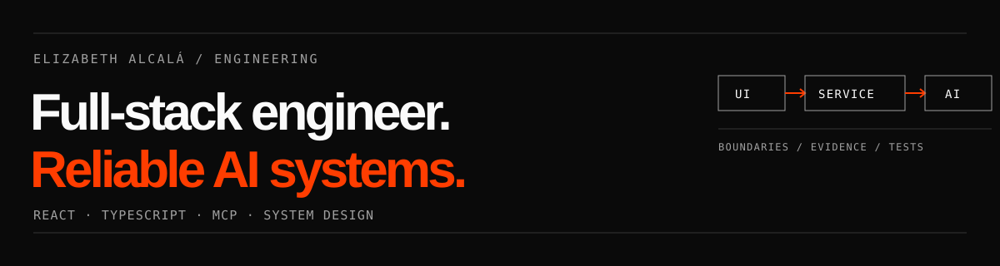

  

# Elizabeth Alcalá

**Senior full-stack engineer · Lima, Perú**

I build web products and AI-powered tools with React and TypeScript. I care about the parts
that make a system dependable: clear service boundaries, concurrent edits, useful
observability, accessible interfaces, and tests that exercise real behavior.

## Tools I work with

| Area | Tools and practices |
| --- | --- |
| Product interfaces | TypeScript, React, Next.js, Tailwind CSS, Storybook, component systems, accessibility |
| AI integration | Model Context Protocol (MCP), agent tool integration, shared iframe host/client packages |
| Data and state | SQL, versioned content, optimistic concurrency, collaborative autosave and replay |
| Delivery and observability | AWS, Vercel, Datadog, CI pipelines, frontend migration |
| In this portfolio | Cloudflare Workers, SQLite/D1 full-text search experiments, Vitest |

## Engineering work

- **AI application infrastructure:** At RAVN, working with SchoolAI, I built shared iframe
  host/client packages, migrated mini-app communication to MCP, and worked on versioned AI
  content storage with optimistic concurrency, autosave, and replay.
- **Frontend architecture:** At Palmsbet, I led a move from vanilla JavaScript to Next.js,
  introduced Storybook and shared component standards, and owned Vercel/AWS delivery for
  the frontend team.
- **Product experiments:** At BairesDev, working with Pinterest, I shipped merchant
  onboarding improvements and used SQL to analyze A/B experiments.

## Public work

- **[Portfolio and engineering notes](https://github.com/elisealcala/portfolio-nextjs)** —
  a statically exported Next.js site with selected experience, technical notes, and a
  Cloudflare Workers deployment path.
- **[Engineering Knowledge Explorer study](https://github.com/elisealcala/portfolio-nextjs/tree/main/experiments/knowledge-explorer)** —
  an exploration of cited answers over published notes, SQLite FTS5 retrieval, rate
  limits, and bounded AI spending. The live agent is not deployed.
- **[Storybook + Tailwind + TypeScript](https://github.com/elisealcala/storybook-tailwind-ts)**
  and **[React + Electron + TypeScript](https://github.com/elisealcala/electron-react-ts)** —
  earlier public experiments with component systems and desktop app setup.

I write about [service boundaries](https://github.com/elisealcala/portfolio-nextjs/blob/main/content/notes/service-boundaries.md),
[optimistic concurrency](https://github.com/elisealcala/portfolio-nextjs/blob/main/content/notes/optimistic-concurrency.md),
[authorization](https://github.com/elisealcala/portfolio-nextjs/blob/main/content/notes/delegated-authorization.md),
and [testing persistence](https://github.com/elisealcala/portfolio-nextjs/blob/main/content/notes/persistence-testing.md).
These notes are engineering studies, not claims that every design was shipped.

---

[LinkedIn](https://www.linkedin.com/in/elisealcala/) ·
[Email](mailto:elizabethalcala28@gmail.com) ·
[GitHub](https://github.com/elisealcala)
